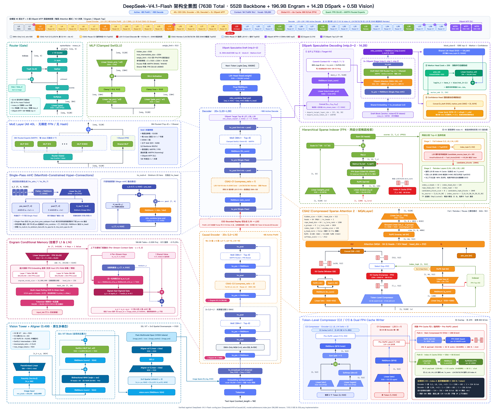

# DeepSeek-V4.1-Flash Architecture



- **High-res PNG (`7200 × 5960`)**: [`deepseek_v41_flash_architecture.png`](deepseek_v41_flash_architecture.png)
- **High-res JPG (`7200 × 5960`)**: [`deepseek_v41_flash_architecture.jpg`](deepseek_v41_flash_architecture.jpg)
- **Editable Vector Source (SVG)**: [`deepseek_v41_flash_architecture.svg`](deepseek_v41_flash_architecture.svg)
- **Diagram Generator**: [`generate_architecture_diagram.py`](generate_architecture_diagram.py)

## Overview

DeepSeek-V4.1-Flash (`DeepseekV41ForCausalLM`, `model_type = deepseek_v41`) is a
**763B-parameter** multimodal Mixture-of-Experts model with a **40-layer Causal
Encoder-Decoder (CED)** backbone, **196.9B Engram conditional memory**, a
**32-layer native ViT + Aligner**, and a **3-layer DSpark speculative draft
head**, supporting **1M context** (`YaRN 16×`, `orig = 65,536`) at **890 B/token**
of persistent global KV + Index-K cache.

| Component | Parameters | Notes |
| --- | ---: | --- |
| 40L Backbone (`hidden=5120`, Embed + untied LM-Head) | `551.6B` | All 40 layers are MoE (`384` routed MXFP4 + `1` shared FP8, `top-6`) |
| Engram Conditional Memory (`L1`, `L14`) | `196.9B` | `196.6B` FP8 lookup tables (`~384M × 256` per layer) + `0.32B` `wkv`/gate |
| DSpark Draft (`mtp.0–2`, `block_size=5`) | `14.2B` | 3 SWA stages (`128` routed `top-3` + `1` shared) + Markov (`r=256`) + Confidence head |
| Vision Tower + Aligner | `0.49B` | 32L ViT (`dim=1024, 16h, patch=14, 2D-RoPE`) + `3×3` unfold GELU Aligner |
| **Total Checkpoint** | **~763B** | 96,085 tensors / `510.3 GB` mixed MXFP4 + FP8 + BF16 |
| **Active / Token (Prefill / Decode)** | **~8B / ~16B** | CED bounded replay cuts bulk prompt prefill after L20 C1 KV/Index-K write |

## Layer Topology (`40L + 3 MTP`)

| Layers | Stage | Attention Mode | `compress_ratio` | KV / Index Sharing & Hooks |
| --- | --- | --- | ---: | --- |
| `L0–L1` | Causal Encoder | SWA-Only MQA (`win=128`, `θ=10K`) | `0` | **Engram @ L1** (`98.3B`) |
| `L2, L8, L14` | Causal Encoder | **CSA2-Full (C2)** | `2` | Own C2 Compressor + Index-K (`wk`, `k_norm`); **Engram @ L14** (`98.3B`) |
| `L3–7, L9–13, L15–19` | Causal Encoder | **CSA2-Reuse (C2)** | `2` | Reuse group's C2 KV & `top-512` indices + own SWA-128 |
| `L20` | Decoder (CED Cut) | **CSA2-Full (C1 + Candidate Src)** | `1` | Sole Decoder global KV & Index-K source + publishes `top-2048` blocks (`block=8`, ≤16K tokens) |
| `L24, L28, L32, L36` | Decoder | **CSA2-Reindex (C1)** | `1` | Reuse L20 C1 KV & Index-K; rescore **only within L20's 2048 candidate blocks** → `top-512` |
| `L21–23, 25–27, 29–31, 33–35, 37–39` | Decoder | **CSA2-Reuse (C1)** | `1` | Reuse L20 C1 KV & group `top-512` + own SWA-128; **DSpark target tap @ L37–39** |
| `MTP 0–2` | DSpark Draft | SWA-Only MQA (`win=128`) | `0` | `main_proj(15360→5120)` injects target KV; `128E top-3` + Markov + Confidence head |

## Global Persistent KV + Index-K Cache Accounting (`890 B / token`)

- **Main Compressed KV (`512` dims)**: FP4 `E2M1` (`256 B`) + per-16 `E4M3FN` scale (`32 B`) = **`288 B / slot`**
- **Index-K (`128` dims)**: FP4 `E2M1` (`64 B`) + per-32 `UE8M0` scale (`4 B`) = **`68 B / slot`**
- **Per-token total**:
  - Encoder 3× `C2` sources (`L2, L8, L14`, `ratio = 2`): `3 × (288 + 68) / 2 = 534 B/tok`
  - Decoder 1× `C1` source (`L20`, `ratio = 1`): `1 × (288 + 68) / 1 = 356 B/tok`
  - **Total persistent global cache**: `534 + 356 = 890 B/tok` (+ fixed bounded SWA `128` tokens/layer)

## Key Structural Changes vs. DeepSeek-V4 Pro

1. **CED Split + Bounded Replay**: 20L Encoder + 20L Decoder (`~8B` prefill / `~16B` decode).
2. **CSA2 Simplified Compressors**: `C2` (no overlap, no APE) and `C1` (no `wgate`), replacing `C4A`/`C128A`, paired with cross-layer KV/Index sharing and two-stage candidate-block reindexing (`L20 → L24/28/32/36`).
3. **Attention & Indexer**: `q_head_norm = False`, no Hadamard rotation in Indexer (`RoPE + FP4` directly), `64Q : 1KV`, `o_groups = 8 × 1024`, `index_topk = 512`.
4. **MoE & Single-Pass mHC**: All 40 layers use learned `sqrtsoftplus + noaux_tc` routing (no Hash/Tid2eid layers), dual text/vision biases (`bias` / `bias_vl`), clamped SwiGLU (`swiglu_limit = 10.0`), and Single-Pass mHC (`hc_pre_from_prev_sublayer = True`, no separate `hc_head`).
5. **Engram + Native Vision + DSpark**: Adds `196.9B` O(1) gated N-gram lookup memory (`L1/L14`), a 32L ViT + `3×3` Aligner, and 3-stage DSpark drafting with Markov & Confidence heads.

## Regenerate

```bash
python3 notes/deepseek_v41_flash/generate_architecture_diagram.py
```

Requires Python 3 + Pillow and Google Chrome (used headless at `2×` scale to
rasterize the SVG into `7200 × 5960` PNG/JPG).
